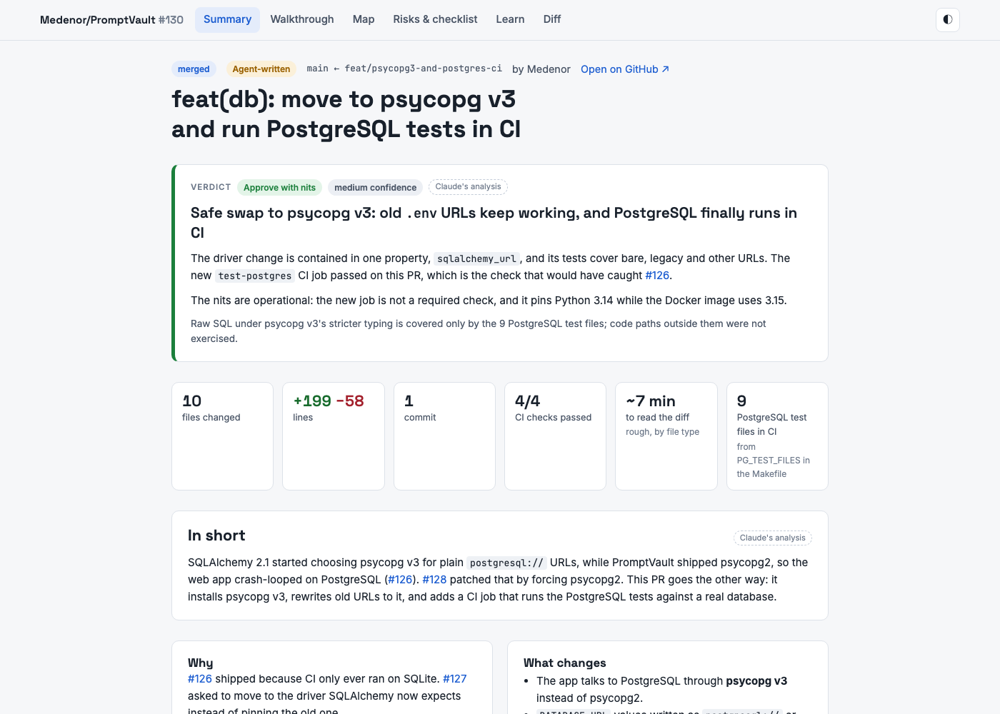
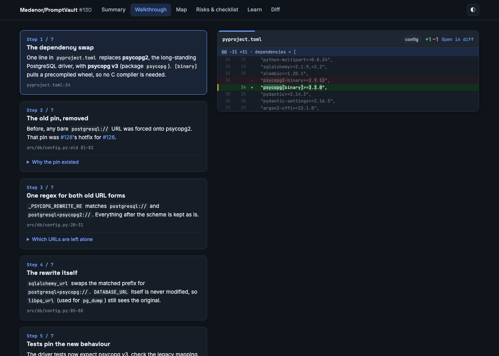
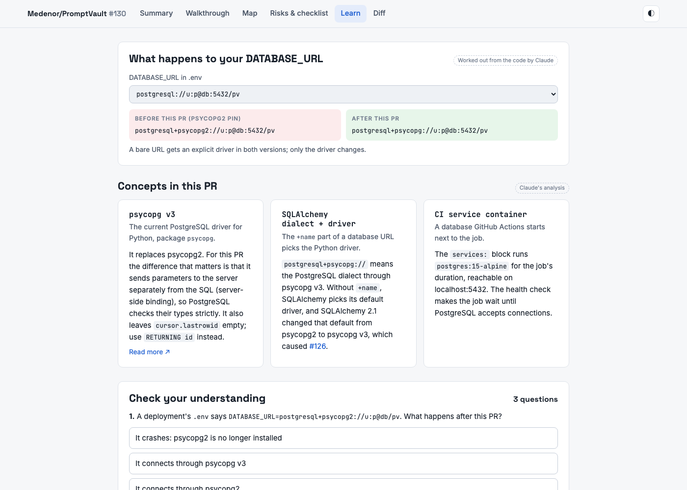

# pr-review-guide

**Understand a pull request before you merge it.** An agent skill for [Claude Code](https://docs.claude.com/en/docs/claude-code) and Claude that turns a GitHub pull request into one interactive review page: a verdict, a check of what the PR claims, a narrated walk through the code, diagrams, risks, a merge checklist, a short quiz and the full diff.

Ask *"help me review #130"* or *"is this PR safe to merge?"* and Claude collects the PR, reads it like a reviewer, and opens the page in your browser.

**[See the demo](https://medenor.github.io/pr-review-guide/demo/)**: a review of a real 10-file PR, [Medenor/PromptVault#130](https://github.com/Medenor/PromptVault/pull/130).



## Why

Coding agents now write a lot of the pull requests we review. They write a thousand lines as easily as fifty, describe their own work with confidence, and sometimes report results they never produced. GitHub's Files tab shows *what* changed. It does not tell you *why*, in which order to read it, what the description gets wrong, or what the diff does not show.

| Problem | What pr-review-guide does |
|---|---|
| **A long diff with no story.** You read files in alphabetical order and rebuild the intent yourself. | A 4–8 step **walkthrough**: steps on the left, a sticky code panel on the right that highlights the lines each step is about as you scroll. |
| **The PR description is taken on trust.** "Tests pass", "no behaviour change", "only two packages change". | A **claims check**: every factual claim gets *verified*, *partly*, *unverified* or *contradicted*, with the evidence (diff lines, CI jobs, commands run). |
| **The bug is in the file nobody touched.** A changed API response breaks a script outside the diff. | The skill searches the whole repo at the PR head for **consumers of every changed contract** (responses, signatures, config keys, tables) and for docs that no longer match the code. |
| **You don't know the library the PR uses.** | **Concept cards** for the tools and terms involved, a **"try it" picker** that shows what the code does with real inputs before and after the PR, and a **quiz** on the PR's behaviour. |
| **An explanation can point at the wrong lines.** | Facts come from scripts (`gh`, `git`); Claude only writes the explanation. Every line reference is **checked against the real diff** before the page is built, and the page labels what is Claude's analysis. |

## What the page contains

Six tabs, each linkable (`index.html#walkthrough`):

| Tab | Contents |
|---|---|
| **Summary** | Verdict and confidence, stats (files, ±, commits, CI, reading time), TL;DR, why / what changes / impact, where the lines are by file type, claims check, CI jobs, linked issues, questions for the author |
| **Walkthrough** | Narrated steps with a sticky code panel that dims the rest of the file and highlights each step's lines (keys `j` / `k`); on phones each step shows its excerpt |
| **Map** | Mermaid diagrams of the mechanism (before/after flows, call sequences) and a reading order: *read*, *glance*, *skip* |
| **Risks & checklist** | Risk scenarios by severity with what would catch them, a merge checklist saved in your browser, review notes to copy into GitHub |
| **Learn** | "Try it" picker, concept cards, quiz with explanations |
| **Diff** | Every file with word-level highlights, Claude's one-line note per file, "Viewed" boxes, links to GitHub's view |

Every line reference on the page is a link that opens the Diff tab at those lines. Light and dark themes, phone width supported.





## Install

Requirements: Python 3.9+, git, and the [GitHub CLI](https://cli.github.com/) (`gh`) logged in to an account that can read the repository. No Python dependencies.

### Claude Code: plugin (recommended)

In a Claude Code session:
```
/plugin marketplace add Medenor/pr-review-guide
/plugin install pr-review-guide@pr-review-guide
```

Claude Code installs only the plugin folder (manifest + skill) into its plugin cache. The skill triggers on its own ("review PR #42", "what does this PR do?", "should I merge this?"), or run it explicitly with `/pr-review-guide:pr-review-guide`.

### Claude Code: standalone skill

Each release carries a ZIP that holds only the skill folder:
```bash
curl -fsSL -o /tmp/pr-review-guide-skill.zip \
  https://github.com/Medenor/pr-review-guide/releases/latest/download/pr-review-guide-skill.zip
unzip -q /tmp/pr-review-guide-skill.zip -d ~/.claude/skills/ && rm /tmp/pr-review-guide-skill.zip
```
To share it with a team through a project, unzip into `<project>/.claude/skills/` instead.

### Claude apps

Download `pr-review-guide-skill.zip` from the [latest release](https://github.com/Medenor/pr-review-guide/releases/latest) and upload it in Claude's skills settings. The environment needs `gh` with access to the repository.

## Use

Ask in plain language:

- "Help me review https://github.com/owner/repo/pull/42"
- "Walk me through #198, Claude wrote most of it"
- "What does the PR I just opened actually change?"

Pages are written to `~/pr-reviews/<owner>-<repo>-<number>/index.html` unless you name another folder.

The two scripts also work on their own:
```bash
S=<skill-dir>/scripts
python3 $S/collect_pr.py collect https://github.com/owner/repo/pull/42 --out ./review   # pr.json + outline
python3 $S/collect_pr.py show ./review/pr.json src/app.py                              # one file, with line numbers
# write ./review/analysis.json (see references/analysis-schema.md), then:
python3 $S/render.py ./review --open                                                    # validate + build the page
```

## How it works

1. **Collect.** `collect_pr.py` reads the PR through `gh`: metadata, diff, CI checks, commits, reviews and linked issues. It classifies files (source, test, migration, CI, config, docs, lockfile, generated), estimates reading time, and flags signs that an agent wrote the PR. GitHub refuses diffs over 300 files or 20,000 lines; `--repo-dir <clone>` diffs from a local clone instead.
2. **Understand.** Claude reads the description and linked issues, prints the important files with their line numbers, searches the repository for consumers of what changed, and checks each claim against the diff, CI and code. Commands run only in a throwaway worktree.
3. **Write.** Claude writes `analysis.json`: verdict, story, diagrams, claims, risks, checklist, concepts, try-it rows and quiz ([schema](plugins/pr-review-guide/skills/pr-review-guide/references/analysis-schema.md)).
4. **Render.** `render.py` validates every reference against `pr.json` (ranges inside the diff, files that exist, a reading order that covers every file, valid quiz answers) and builds one self-contained HTML file. Problems are printed and shown on the page until they are fixed.

**Read-only by design.** The skill never posts comments or reviews, never pushes, and never checks out or modifies your working tree. It may fetch the PR into `refs/pr-review/<n>` in an existing clone. The page offers review notes for you to copy and post yourself.

## Repository layout

```
.claude-plugin/marketplace.json                 marketplace catalog (this repo)
plugins/pr-review-guide/                        the plugin: the only part that gets installed
├── .claude-plugin/plugin.json
└── skills/pr-review-guide/
    ├── SKILL.md                                workflow and writing guidance
    ├── scripts/collect_pr.py                   gh/git → pr.json, outline, per-file view
    ├── scripts/render.py                       validation + page build
    ├── scripts/selftest.py                     offline test suite
    ├── assets/                                 page template, CSS and JS (no build step)
    └── references/analysis-schema.md           the analysis.json format
docs/demo/                                      rendered demo (GitHub Pages)
docs/images/                                    README screenshots
.github/workflows/                              CI self-test + release ZIP
```

## Limits

- **GitHub only** for now (through `gh`). GitLab and Forgejo are not supported.
- **The analysis is Claude's.** References are checked mechanically and claims carry their evidence, but a verdict is a reading of the code, not a proof. The page says which parts are Claude's analysis and what could not be checked.
- **Diagrams need the network.** Mermaid and the fonts load from public CDNs; offline, diagrams show as source text and system fonts are used. Everything else works offline.
- **Very large files** are truncated after 4,000 diff lines, with a link to GitHub.

## Development

```bash
S=plugins/pr-review-guide/skills/pr-review-guide/scripts
python3 $S/selftest.py            # must print "OK"
claude plugin validate .          # marketplace + plugin manifests
```

To release, bump `version` in `plugins/pr-review-guide/.claude-plugin/plugin.json`, then publish a GitHub release tagged `v<version>`. The release workflow checks that the tag matches the version, runs the self-test and attaches `pr-review-guide-skill.zip`.

Pull requests are welcome. Changes to the page or the validation need a case in `selftest.py`.

## Credits

Inspired by [kjetilhartveit/kjetils-skills](https://github.com/kjetilhartveit/kjetils-skills) (`explain-changes`, `explain-visually`) and [Cribelo](https://github.com/cribelo/cribelo). See [ACKNOWLEDGMENTS.md](ACKNOWLEDGMENTS.md).

## License

[MIT](LICENSE)
